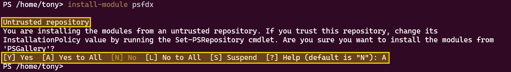
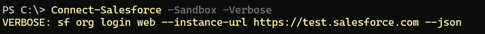

[](https://github.com/tonygward/psfdx/actions/workflows/ci.yml)
Cross platform PowerShell modules that wrap the Salesforce CLI.

# Installation

## 1. Pre-Requisites
PowerShell 7 (Windows, Linux or macOS) or Windows PowerShell 5.1
https://github.com/PowerShell/PowerShell/releases


## 2. Install psfdx

```
Install-Module psfdx
```

PowerShell asks about the untrusted PSGallery repository. Answer `Y` or `A`:



That one command installs everything. The `psfdx` package holds every module (`psfdx`, `psfdx-metadata`, `psfdx-devops`, `psfdx-data`, `psfdx-plugins`, `psfdx-development`, `psfdx-logs`, `psfdx-org`, `psfdx-packages`, `psfdx-agentforce` and the shared helpers): there are no other packages to install. Start a session with:

```
Import-Module psfdx
```

## 3. See the commands

Each module keeps its own name, so every command is listed under the module that holds it:

```
Get-Command -Module psfdx          # the core commands only
Get-Command -Module psfdx-logs     # only the commands the logs module owns
Get-Command -Module 'psfdx*'       # every command, each attributed to its own module
```

Every command is discoverable and autoloads by name in a new session. Until `psfdx` has loaded, `Get-Command` shows `psfdx` as the module of every command; `Import-Module psfdx` (or using any command) loads every module under its own name (details in [docs/install.md](docs/install.md)).

Every command has full help:

```
Get-Help Deploy-SalesforceMetadata -Full          # synopsis, every parameter, examples, CLI mapping
Get-Help Deploy-SalesforceMetadata -Examples
Get-Help Deploy-SalesforceMetadata -Parameter *
```

Default help for each public command shows a **SALESFORCE CLI** section after its behavioural description and before related links. It identifies the underlying `sf` commands and relevant flags, or explains how the cmdlet works without a direct CLI equivalent. The website reference uses the same help and includes an inline example. The help checks use the [CLI parity report](docs/cli-parity.md) and are described in the [help audit](docs/help-audit.md).

## 4. Update psfdx

```
Update-Module psfdx
```

This moves every module to the same new version. How upgrades work, and what to do if a module goes missing, is in [docs/install.md](docs/install.md).

## 5. Salesforce CLI

   You can install the Salesforce CLI by running:

   ```powershell
   Import-Module psfdx
   Install-SalesforceCli
   ```
   On Windows, Linux and macOS it uses npm (`npm install --global @salesforce/cli`), the install method Salesforce supports. `Update-SalesforceCli` runs `npm update --global @salesforce/cli`.<br>
   If you installed the CLI with the old Homebrew tap (`sfdx-cli/tap/sf`), uninstall it with `brew uninstall sfdx-cli/tap/sf` before running `Install-SalesforceCli`.<br>
   psfdx is tested against the latest stable Salesforce CLI: CI installs it and checks every `sf` command and flag psfdx uses against its help, and logs the exact version. No CLI version is pinned. See [docs/cli-compatibility.md](docs/cli-compatibility.md).

# Examples
**1. Connect to a Salesforce Sandbox Org**
```
Import-Module psfdx
Connect-Salesforce -Sandbox
```
A web browser will appear, login to Salesforce as you would normally.

If you enable Verbose messages
```$VerbosePreference = "Continue```

Then **-Verbose** switch reveals the Salesforce CLI commands


**2. Create and use a Salesforce Alias**
```
Add-SalesforceAlias -TargetOrg my@email.com -Alias myalias
Select-SalesforceRecords -Query "SELECT Id, Name FROM Account LIMIT 10" -TargetOrg myalias
```
**3. Retrieve first 10 Salesforce Accounts**
```
Select-SalesforceRecords -Query "SELECT Id, Name FROM Account LIMIT 10" -TargetOrg my@email.com
```
NB you only need to Import-Module psfdx once per PowerShell session

**4. Export Salesforce Debug Logs to Files**
```
Export-SalesforceDebugLogs -TargetOrg my@email.com
```

**5. List every psfdx cmdlet**
```
Get-Command -Module psfdx*
```


## Working on psfdx
The Gallery is the supported way to install psfdx. If you want to change psfdx itself, clone the repository and run `./install.ps1` (Mac or Linux) or `./install-windows.ps1` (Windows). That installs the modules separately, so each one is imported on its own (for example `Import-Module psfdx-logs`). Don't combine it with the Gallery install on the same machine. See [CLAUDE.md](CLAUDE.md) and [docs/](docs/) for how the project is built and tested.


## Pipelines

Reading cmdlets return objects, and the cmdlets that change things take the ID from the pipeline, so a query can feed a change:

```powershell
Select-SalesforceRecords -Query "SELECT Id FROM Account WHERE Name LIKE 'Test%'" -TargetOrg myorg |
    Remove-SalesforceRecord -Type Account -TargetOrg myorg -WhatIf          # previews every delete
Get-SalesforceDebugLogging -TargetOrg myorg | Disable-SalesforceDebugLogging -TargetOrg myorg
Get-SalesforcePackageVersions -PackageName MyPkg | Remove-SalesforcePackageVersion -WhatIf
```

- **Piped ID parameters.** `Remove-`, `Get-` and `Set-SalesforceRecord` take `-Id` (or `RecordId`) from the pipeline; the object type is not in a query result, so `-Type` is always given. `Remove-` and `Promote-SalesforcePackageVersion` take the `SubscriberPackageVersionId`; `Disable-SalesforceDebugLogging` takes the trace flag `Id`.
- **Each piped object is its own operation.** Every mutation asks for confirmation and honours `-WhatIf` and `-Confirm` per object. `New-` and `Set-SalesforceRecord` support `-WhatIf` but do not prompt by default; `Remove-` cmdlets prompt.
- **Empty results.** A query or list with no rows emits nothing, so a pipeline after it does nothing. Use `@(...)` to get an empty array in a variable.
- **One result or many.** PowerShell unrolls a single result into the object itself, so wrap a call in `@(...)` when you need a stable array (`@(Select-SalesforceRecords ...).Count`).
- **Errors.** A failure reported by the Salesforce CLI throws, with the CLI's message, and stops the pipeline. A piped record whose ID is not a valid Salesforce ID is reported as an error for that record and skipped; use `-ErrorAction Stop` to stop instead. No result data is discarded or turned into text.

## Salesforce CLI coverage

How much of the Salesforce CLI does psfdx wrap? [docs/cli-parity.md](docs/cli-parity.md) answers it command by command. It compares the latest stable `sf` with the commands the modules actually run, not with cmdlet counts, and shows for every command whether psfdx wraps it, wraps part of it, has not covered it, or leaves it out on purpose. For the commands psfdx runs it goes down to the flags and their values: which flags no cmdlet passes (a required one is marked), and which of the values the CLI lists for a flag (such as `--test-level`) psfdx cannot pass.

- **Read it per plugin set.** The report is for the core plugins that ship with the CLI and, separately, the just-in-time plugins it installs on first use. A percentage means "of the commands in that set that apply to a PowerShell wrapper", never of the whole CLI.
- **Missing is not a promise.** A gap with no reason has simply not been decided. A reviewed gap carries a reason or an issue link. The reviewed classifications are in [docs/cli-parity-mapping.json](docs/cli-parity-mapping.json); everything else is read from the code.
- **Regenerate it** with `./scripts/parity/New-CliParityReport.ps1` (offline, no CLI, org or credentials needed) after you add a cmdlet that runs `sf`. A test fails if the committed report is out of date. To compare against a newer CLI, install it and run `./scripts/parity/New-CliInventorySnapshot.ps1` first. The machine-readable twin is [docs/cli-parity.json](docs/cli-parity.json).

## Licence

psfdx is released under the MIT licence. See [LICENSE](LICENSE).

## Modules
| Module | Description |
| :--- | :--- |
| `psfdx` | Core cmdlets for authentication, record operations, org management, and utilities. |
| `psfdx-logs` | Debug Logs, Login History and Event Monitoring. |
| `psfdx-metadata` | Retrieve, deploy and describe Salesforce metadata. |
| `psfdx-devops` | Salesforce DevOps Center: projects, work items, pipelines, stages, promotion and the beta pipeline deploys. |
| `psfdx-data` | Salesforce data: SOQL and SOSL queries, single records, files, tree data and Bulk API 2.0 jobs. |
| `psfdx-plugins` | Salesforce CLI plugins: install, list, inspect, update, uninstall, discover, reset, signature checks and the allowlist. |
| `psfdx-development` | Salesforce DX development (projects, tests, deploy). |
| `psfdx-org` | Salesforce org lifecycle: sandboxes and scratch orgs. |
| `psfdx-packages` | Salesforce packages: create, version, promote, install. |
| `psfdx-agentforce` | Agentforce agent tests and activation through the Salesforce CLI agent plugin. |


### psfdx

Included in the `psfdx` package.

### Authentication & Orgs

| Cmdlet | Description |
| :--- | :--- |
| `Connect-Salesforce` | Web-based org authentication. Also takes `-ClientApp`, `-Scopes` and `-Username`. |
| `Connect-SalesforceAccessToken` | Log in with an access token you already have. The token is a `SecureString`, handed to `sf` in the environment, never on the command line (`sf org login access-token`). |
| `Get-SalesforceOrgDetails` | Show one org's ID, instance URL, user and status. Tokens and auth URLs are removed unless `-IncludeToken` (`sf org display`). |
| `Get-SalesforceAuthorizations` | List every login saved on this computer, without contacting the orgs (`sf org list auth`). |
| `Connect-SalesforceAuthUrl` | Authenticate using a stored SFDX auth URL file (supports alias/default flags and hides tokens and auth URLs unless `-IncludeToken`; `-IncludeToken` only returns what the CLI itself provides). |
| `Disconnect-Salesforce` | Logout from Salesforce org (asks for confirmation, supports `-WhatIf`). `-ClientApp` logs out of one client app login. |
| `Connect-SalesforceJwt` | JWT-based authentication. |
| `Open-Salesforce` | Open org in a browser or get URL. `-Path` opens a page, `-SourceFile` opens a project file's component. |
| `Get-SalesforceConnections` | List connected orgs (excluding scratch orgs). |
| `Repair-SalesforceConnections` | Clean up stale connections. |

### Aliases

| Cmdlet | Description |
| :--- | :--- |
| `Get-SalesforceAlias` | List Salesforce aliases. |
| `Add-SalesforceAlias` | Create/update an alias. |
| `Remove-SalesforceAlias` | Remove an alias, or every alias with `-All` (asks first; `-NoPrompt` skips the question, `-WhatIf` works). |

### Limits & Usage

| Cmdlet | Description |
| :--- | :--- |
| `Get-SalesforceLimits` | Retrieve org limits (API, storage, etc.). |
| `Get-SalesforceDataStorage` | Calculate data storage usage and percent. |
| `Get-SalesforceApiUsage` | Calculate API usage percent. |

### Users and permissions

| Cmdlet | Description |
| :--- | :--- |
| `Get-SalesforceUsers` | List users with optional filters (username, active only, limit). |
| `Get-SalesforceAuthenticatedUser` | List the users of an org that the CLI has authorised here (`sf org list users`); tokens removed. |
| `Get-SalesforceOrgUser` | Show the user the CLI is signed in as (`sf org display user`); never returns the token or password (the CLI redacts them), only `HasPassword`. |
| `New-SalesforceUser` | Create a user from a definition file and/or `-Field` values (`sf org create user`). Supports `-WhatIf`. |
| `New-SalesforceUserPassword` | Generate a password for a user, returned as a SecureString (`sf org generate password`). Asks for confirmation. |
| `Grant-SalesforcePermissionSet` | Assign permission sets to users (`sf org assign permset`); re-running is safe (`AlreadyAssigned`). Asks for confirmation. |
| `Grant-SalesforcePermissionSetLicense` | Assign permission set licences to users (`sf org assign permsetlicense`). Asks for confirmation. |

### REST API

| Cmdlet | Description |
| :--- | :--- |
| `Connect-SalesforceApi` | OAuth2 password flow (non-SFDX REST). |
| `Invoke-SalesforceApi` | Invoke REST API with bearer token. |
| `Get-SalesforceApiVersions` | Current Salesforce API versions. |
| `Get-SalesforceApiVersions` | Latest Salesforce API version. |
| `Invoke-SalesforceRestRequest` | Any REST request as the CLI's logged-in user (`sf api request rest`): `-Url`, `-Method`, `-Body` / `-BodyFile` / `-File`, `-Header`, `-Include`, `-StreamToFile`, `-AsObject`. Writes ask first and support `-WhatIf`. |
| `Invoke-SalesforceGraphQL` | Run a GraphQL query or mutation (`sf api request graphql`) from `-Query` or `-QueryFile`; a mutation asks first. |

### Salesforce CLI

| Cmdlet | Description |
| :--- | :--- |
| `Install-SalesforceCli` | Install the Salesforce CLI. |
| `Update-SalesforceCli` | Update the Salesforce CLI. |

### Experience Cloud

| Cmdlet | Description |
| :--- | :--- |
| `Get-SalesforceCommunityTemplates` | List the Experience Cloud site templates of an org. |
| `New-SalesforceCommunity` | Create a site from a template (`-UrlPathPrefix`, `-Description`). |
| `Publish-SalesforceCommunity` | Publish a site to make it live (asks first). |

### Diagnostics

| Cmdlet | Description |
| :--- | :--- |
| `Invoke-SalesforceDoctor` | Run `sf doctor`: gather the CLI's configuration and run diagnostics. `-CreateIssue` shares the results on GitHub, so it asks first. |

### Utilities

| Cmdlet | Description |
| :--- | :--- |
| `ConvertTo-SalesforceSoqlLiteral` | Turn a value into a quoted SOQL literal with SOQL's backslash escapes, so a value can never change the meaning of a query. |
| `ConvertTo-SalesforceSoqlIdentifier` | Check an object or field API name and return it, or throw, before it goes into a query. |
| `ConvertTo-SalesforceSoqlDateTime` | Turn a date into a SOQL datetime literal in UTC (a local time is converted, never labelled as UTC). |
| `Get-SalesforceDateTime` | Format the current or a given datetime as a Salesforce UTC literal. Local time is converted to UTC first. |


### psfdx-metadata

Included in the `psfdx` package.

### Retrieve

| Cmdlet | Description |
| :--- | :--- |
| `Retrieve-SalesforceComponent` | Retrieve specific metadata component by type/name. |
| `Retrieve-SalesforceMetadata` | Retrieve metadata using a package.xml manifest. |
| `Retrieve-SalesforcePackage` | Retrieve metadata for an unlocked package. |
| `Retrieve-SalesforceField` | Retrieve a specific custom field. |
| `Retrieve-SalesforceValidationRule` | Retrieve a specific validation rule. |
| `Retrieve-SalesforceOrg` | Retrieve entire Salesforce Org. |

### Deploy

| Cmdlet | Description |
| :--- | :--- |
| `Deploy-SalesforceComponent` | Deploy specific metadata by type/name. |
| `Deploy-SalesforceMetadata` | Deploy using a manifest, metadata directory, or single-package artifact. Also takes `-PreDestructiveChanges`, `-PostDestructiveChanges`, `-PurgeOnDelete`, `-Async`, `-CoverageFormatters`, `-Junit` and `-ResultsDir`. |
| `Test-SalesforceDeploy` | Validate a deployment without saving it (check-only); use `-Manifest`, `-SourceDir` or `-InputDir` (a Metadata API directory or `.zip`); returns a job ID for quick deploy. Tests always run (`NoTests` is not allowed); `-Metadata` validates named components, and the destructive-changes and `-CoverageFormatters`/`-Junit`/`-ResultsDir` options match `Deploy-SalesforceMetadata`; `-TestLevel` is `SpecificTests`, `ReferencedTests`, `TestsInFolder`, `TestsInOrg` (default), `TestsInOrgAndPackages` or `RelevantTests`. |
| `Start-SalesforceQuickDeploy` | Quick deploy a validated deployment by `-JobId` or `-UseMostRecent` (asks for confirmation). |
| `Get-SalesforceDeployStatus` | Report the status of a deployment by `-JobId` or `-UseMostRecent`. |
| `Resume-SalesforceDeploy` | Resume watching a deployment that is still running, by `-JobId` or `-UseMostRecent`. The org comes from the cached deployment, so there is no `-TargetOrg`. |
| `Get-SalesforceDeployPreview` | Read-only preview of what a deploy would send, with conflicts, deletes and ignored files, from `sf project deploy preview`. Needs a source-tracked org. Narrow with `-SourceDir`, `-Manifest` or `-Metadata`. |
| `Get-SalesforceRetrievePreview` | Read-only preview of what a retrieve would bring down and any conflicts, from `sf project retrieve preview`. Needs a source-tracked org. |
| `Stop-SalesforceDeploy` | Cancel a running deployment (asks for confirmation). |

`Get-SalesforceDeployStatus` and `Resume-SalesforceDeploy` also write test and coverage results with `-CoverageFormatters`, `-Junit` and `-ResultsDir`. `Get-SalesforceDeployPreview` and `Get-SalesforceRetrievePreview` take `-ConciseResults`. `Retrieve-SalesforceComponent` takes `-SourceDir` and `-RootTypeWithDependencies`; `Retrieve-SalesforceMetadata` takes `-SinglePackage` and `-ZipFileName`.

### Manifest, conversion and source tracking

| Cmdlet | Description |
| :--- | :--- |
| `New-SalesforceManifest` | Write a package.xml (or destructive-changes manifest) from metadata names, local source or an org (`sf project generate manifest`). |
| `ConvertTo-SalesforceSourceFormat` | Convert Metadata API files into source format (`sf project convert mdapi`). |
| `ConvertTo-SalesforceMdapiFormat` | Convert source format into Metadata API format (`sf project convert source`). |
| `Enable-SalesforceSourceBehavior` | Beta. Turn on a source behavior such as decomposed permission sets (`sf project convert source-behavior`); `-DryRun` shows the change. |
| `Get-SalesforceIgnoredFiles` | List the files `.forceignore` leaves out (`sf project list ignored`). |
| `Remove-SalesforceSource` | Delete components from the org and the project (asks for confirmation; `-CheckOnly` validates; `-NoPrompt` skips the question). |
| `Remove-SalesforceSourceTracking` | Delete the local source tracking files of an org (asks for confirmation). |
| `Reset-SalesforceSourceTracking` | Reset local and remote source tracking to a `-Revision` (asks for confirmation). |

### Custom metadata types

These write metadata files into the current Salesforce DX project and return the CLI result as an object. Run them inside a project. Only the last one reads an org.

| Cmdlet | Description |
| :--- | :--- |
| `New-SalesforceCustomMetadataType` | Create a custom metadata type (`sf cmdt generate object`): `-TypeName`, `-Label`, `-PluralLabel`, `-Visibility`, `-OutputDirectory`. |
| `New-SalesforceCustomMetadataField` | Create a field of a type (`sf cmdt generate field`): `-Name`, `-Type` (Checkbox to Url), `-PicklistValues`, `-DecimalPlaces`. |
| `New-SalesforceCustomMetadataRecord` | Create one record with `-Values @{ Field__c = 'x' }` (`sf cmdt generate record`). |
| `New-SalesforceCustomMetadataRecordsFromCsv` | Create one record per CSV row, named from `-NameColumn` (`sf cmdt generate records`). |
| `New-SalesforceCustomMetadataTypeFromOrg` | Turn a custom object or custom setting in an org into a type plus its records (`sf cmdt generate fromorg`). |

### Schema generators

These write metadata source files into the current Salesforce DX project and need no org.

| Cmdlet | Description |
| :--- | :--- |
| `New-SalesforceCustomObject` | Create a custom object, with its Name field (`sf schema generate sobject`). Interactive: it asks questions, so run it in a terminal as a plain command (see below). `-UseDefaultFeatures` skips the feature questions. |
| `New-SalesforceCustomField` | Create a custom field on an object (`sf schema generate field`). Interactive. `-ObjectDirectory` names the object's source folder. |
| `New-SalesforcePlatformEvent` | Create a platform event (`sf schema generate platformevent`). Interactive. |
| `New-SalesforceCustomTab` | Create a custom tab for a custom object (`sf schema generate tab`). Not interactive: `-ObjectName`, `-Directory` (must exist) and `-Icon` 1 to 100. Returns the CLI result. |

The three interactive cmdlets refuse to run in a session without a terminal, such as a script run with redirected input or output, and tell you so instead of waiting for answers that never come. Run them as a plain command: if you assign their output to a variable or pipe it, PowerShell captures the output and the questions are hidden.

### Describe

| Cmdlet | Description |
| :--- | :--- |
| `Describe-SalesforceObjects` | List Objects for a target org; `-Category` all, standard or custom. |
| `Describe-SalesforceObject` | Describe a specific Object (supports tooling API). |
| `Describe-SalesforceFields` | List fields for an Object. |
| `Describe-SalesforceMetadataTypes` | List available metadata types. `-OutputFile` also writes the CLI's full result to a file. |
| `Get-SalesforceMetadataComponents` | List the components of one metadata type in an org, with `-Folder` for folder types (`sf org list metadata`). |

### Utilities

| Cmdlet | Description |
| :--- | :--- |
| `Build-SalesforceQuery` | Build a SELECT for all fields on an Object. |

### psfdx-devops

Installed with `Install-Module psfdx`. Every cmdlet that runs a command of the Salesforce CLI DevOps Center plugin (`@salesforce/plugin-devops-center`) lives in this module: the 26 `sf devops` commands and the 5 beta `sf project deploy pipeline` commands. They were in `psfdx-metadata` before; the cmdlet names, parameters and behaviour are unchanged, only the module that holds them (the `Source` in `Get-Command`) is new.

### DevOps Center pipeline deploys (beta)

These run the beta `sf project deploy pipeline` commands. They need a DevOps Center org you are logged in to (`-DevOpsCenterUsername`), and because the CLI commands are beta their names, flags and results can change in a later Salesforce CLI release; psfdx does not promise they stay stable. The cmdlets that change an org ask for confirmation and support `-WhatIf`.

| Cmdlet | Description |
| :--- | :--- |
| `Start-SalesforcePipelineDeploy` | Deploy a branch to a pipeline stage (`sf project deploy pipeline start`). |
| `Test-SalesforcePipelineDeploy` | Validate a branch deployment without deploying (`... pipeline validate`). |
| `Start-SalesforcePipelineQuickDeploy` | Quick deploy a validated pipeline deployment by `-JobId` or `-UseMostRecent` (`... pipeline quick`). |
| `Get-SalesforcePipelineDeployStatus` | Report the status of a pipeline deployment (`... pipeline report`). |
| `Resume-SalesforcePipelineDeploy` | Resume watching a pipeline deployment (`... pipeline resume`). |

Validate, then quick deploy, and resume or report on a running deployment:

```powershell
$validation = Test-SalesforceDeploy -SourceDir force-app -TestLevel TestsInOrg -TargetOrg prod -Wait 30
Start-SalesforceQuickDeploy -JobId $validation.id -TargetOrg prod

Resume-SalesforceDeploy -UseMostRecent -Wait 10
Get-SalesforceDeployStatus -JobId 0AfXXXXXXXXXXXXXXX -TargetOrg prod
Stop-SalesforceDeploy -JobId 0AfXXXXXXXXXXXXXXX -WhatIf
```

### DevOps Center (sf devops)

These run the `sf devops` commands. They need a DevOps Center org that you are logged in to (`-TargetOrg`, or the `target-org` configuration) and a user who is allowed to work with DevOps Center; the CLI reports a permission error if not. The commands come from the `@salesforce/plugin-devops-center` plugin, which the CLI installs the first time it needs it. Anything that deletes or deploys asks for confirmation (use `-Confirm:$false` in a script) and every change supports `-WhatIf`. IDs are the 15 or 18 character Salesforce IDs the list cmdlets return.

| Cmdlet | Description |
| :--- | :--- |
| `Get-SalesforceDevOpsProject` | List the projects (`project list`). |
| `New-SalesforceDevOpsProject` | Create a project (`project create`). |
| `Update-SalesforceDevOpsProject` | Rename, describe, or activate / deactivate with `-IsActive` / `-IsActive:$false` (`project update`). |
| `Get-SalesforceDevOpsWorkItem` | List the work items of a project (`work-item list`). |
| `New-SalesforceDevOpsWorkItem` | Create a work item (`work-item create`). |
| `Update-SalesforceDevOpsWorkItem` | Change the subject, description or status, by `-WorkItemId` or `-WorkItemName` (`work-item update`). |
| `Initialize-SalesforceDevOpsWorkItem` | Prepare a work item for a one-off promotion: creates branches and pull requests (`work-item prepare`). |
| `Join-SalesforceDevOpsWorkItem` | Combine work items so they promote together (`work-item combine`). |
| `New-SalesforceDevOpsReview` | Open a pull request for a work item branch (`review create`). |
| `Get-SalesforceDevOpsPipeline` | List the pipelines with their stages, repositories and projects (`pipeline list`). |
| `Get-SalesforceDevOpsPipelineDetails` | One pipeline in detail (`pipeline get`). |
| `New-SalesforceDevOpsPipeline` | Create a pipeline on an existing or new GitHub or Bitbucket repository (`pipeline create`). |
| `Update-SalesforceDevOpsPipeline` | Rename, `-Activate` (asks first) or `-Deactivate` (`pipeline update`). |
| `Add-SalesforceDevOpsPipelineProject` / `Remove-SalesforceDevOpsPipelineProject` | Attach or disconnect a project (`pipeline project add` / `delete`). |
| `Add-SalesforceDevOpsPipelineStage` / `Update-SalesforceDevOpsPipelineStage` / `Remove-SalesforceDevOpsPipelineStage` | Add, rename or delete a stage (`pipeline stage add` / `update` / `delete`). |
| `Add-SalesforceDevOpsStageBranch` / `Remove-SalesforceDevOpsStageBranch` | Assign or remove the branch of a stage (`stage branch add` / `delete`). |
| `Add-SalesforceDevOpsStageEnvironment` / `Remove-SalesforceDevOpsStageEnvironment` | Connect (an OAuth login that opens a browser) or remove the environment of a stage (`stage environment add` / `delete`). |
| `Start-SalesforceDevOpsPromotion` | Promote work items (`-WorkItemId`) or a whole stage (`-StageId`) to a stage (`promote`). |
| `Complete-SalesforceDevOpsPromotion` | Deploy work items merged outside DevOps Center (`promotion complete`). |
| `Test-SalesforceDevOpsPromotion` | Check that work items can be promoted, without deploying (`promotion validate`). |
| `Get-SalesforceDevOpsRequestStatus` | Status of a request, from its token (`request status`). |

```powershell
$wi = Get-SalesforceDevOpsWorkItem -ProjectId 1Qg000000000001 -TargetOrg devops-org
Test-SalesforceDevOpsPromotion -WorkItemId $wi[0].id -TargetStageId 1QV000000000002 -TargetOrg devops-org
Start-SalesforceDevOpsPromotion -WorkItemId $wi[0].id -TargetStageId 1QV000000000002 -TargetOrg devops-org -WhatIf
```
### psfdx-data

Included in the `psfdx` package. It holds the Salesforce data commands: queries and single records (they were part of `psfdx`), tree data, and the Bulk API 2.0 commands (this module was `psfdx-data` before). Every command keeps its name, parameters and behaviour.

#### Records and queries

| Cmdlet | Description |
| :--- | :--- |
| `Select-SalesforceRecords` | Run SOQL and return records. |
| `Search-SalesforceRecords` | Run a SOSL text search and return the matches as objects, each with its `SObject` (`sf data search`). `-File` reads the search from a file; `-ResultFormat` csv or human returns the CLI text. |
| `New-SalesforceRecord` | Create a record. `-SkipAssignmentRules` skips Case and Lead assignment rules. |
| `Set-SalesforceRecord` | Update a record by `-Id` or by `-Where` field values that identify exactly one record. `-SkipAssignmentRules` skips Case and Lead assignment rules. |
| `Get-SalesforceRecord` | Get one record by `-Id`, or by `-Where` field values that identify exactly one (`sf data get record`). |
| `Remove-SalesforceRecord` | Delete one record by `-Id` or `-Where` (`sf data delete record`). Asks for confirmation; supports `-WhatIf`. |
| `Upsert-SalesforceRecord` | Create or update one record by external ID through `sf api request rest`. Returns `Operation` (Created or Updated), `Created`, `Id` when the API supplies it, and `StatusCode`. |
| `Get-SalesforceRecordType` | List record types (optionally by object). |
| `Get-SalesforceSObjectRecordCount` | Approximate record counts for all supported objects or the ones named with `-SObject` (`sf org list sobject record-counts`). |
| `New-SalesforceFile` | Upload a local file as a Salesforce File, optionally attached to a record with `-ParentId` (`sf data create file`). Supports `-WhatIf`. |

#### Tree data

| Cmdlet | Description |
| :--- | :--- |
| `Export-SalesforceTreeData` | Export records with their child records to JSON (and with `-Plan`, a plan file) for copying test data between orgs (`sf data export tree`). |
| `Import-SalesforceTreeData` | Import tree JSON files or a plan into an org (`sf data import tree`); `-Plan` or `-File`, not both. Supports `-WhatIf`. |

#### Bulk API 2.0

| Cmdlet | Description |
| :--- | :--- |
| `Export-SalesforceBulkData` | Export a SOQL query to a file with Bulk API 2.0 (`sf data export bulk`). Returns a `JobId` at once, or the row count with `-WaitMinutes`. |
| `Import-SalesforceBulkData` | Insert the rows of a CSV with Bulk API 2.0 (`sf data import bulk`). Supports `-WhatIf`. |
| `Update-SalesforceBulkData` | Update records from a CSV with Bulk API 2.0 (`sf data update bulk`). Supports `-WhatIf`. |
| `Upsert-SalesforceBulkData` | Upsert records from a CSV by external ID with Bulk API 2.0 (`sf data upsert bulk`). Supports `-WhatIf`. |
| `Remove-SalesforceBulkData` | Delete the records whose IDs are in a CSV with Bulk API 2.0 (`sf data delete bulk`). `-HardDelete` deletes permanently. Asks for confirmation, supports `-WhatIf`. |
| `Get-SalesforceBulkJobStatus` | Read the status of a bulk job, or one batch, from the org (`sf data resume`). |
| `Resume-SalesforceBulkJob` | Resume an export, import, update, upsert or delete job by `-JobId`, or the latest with `-UseMostRecent`, in a later step. The CLI finds the org from its record of the job, so it must have been created on this computer. |
| `Get-SalesforceBulkResult` | Get a bulk ingest job's counts and save its success, failed and unprocessed row CSVs to `-OutputDirectory` (`sf data bulk results`). Works for any job in the org. |


Delete the accounts whose IDs are in a CSV, look at the job, and get the result files:

```powershell
$job = Remove-SalesforceBulkData -File .\old-accounts.csv -Object Account -WhatIf    # preview first
$job = Remove-SalesforceBulkData -File .\old-accounts.csv -Object Account -TargetOrg dev1
Get-SalesforceBulkJobStatus -JobId $job.JobId -TargetOrg dev1
Get-SalesforceBulkResult -JobId $job.JobId -TargetOrg dev1
```

### psfdx-plugins

Installed with `Install-Module psfdx`. Every cmdlet that manages Salesforce CLI plugins (the `sf plugins` commands) is in this module: install, list, inspect, update, uninstall, discover and reset plugins, check plugin signatures, and manage the allowlist. They were in `psfdx` before; the cmdlet names, parameters and behaviour are unchanged, only the module that holds them (the `Source` in `Get-Command`) is new. `Install-SalesforceCli` and `Update-SalesforceCli`, which install the CLI itself rather than a plugin, stay in `psfdx`.

| Cmdlet | Description |
| :--- | :--- |
| `Install-SalesforcePlugin` | Install a Salesforce CLI plugin. |
| `Get-SalesforcePlugins` | List installed plugins (optionally core). |
| `Update-SalesforcePlugins` | Update installed plugins. |
| `Uninstall-SalesforcePlugin` | Remove plugins (asks first). |
| `Get-SalesforcePluginDetails` | Version and install details of plugins (`sf plugins inspect`). |
| `Find-SalesforcePlugins` | List third-party plugins you can install (`sf plugins discover`). |
| `Reset-SalesforcePlugins` | Remove every user-installed and linked plugin, optionally reinstalling (asks first). |
| `Test-SalesforcePluginSignature` | Check the digital signature of an npm plugin package. |
| `Get-SalesforcePluginAllowlist` | List the plugins allowed without a Salesforce signature. |
| `Add-SalesforcePluginAllowlist` | Allow unsigned plugins (asks first). |
| `Remove-SalesforcePluginAllowlist` | Take plugins off the allowlist (asks first). |

### psfdx-development

Included in the `psfdx` package.

### Projects & Config

| Cmdlet | Description |
| :--- | :--- |
| `New-SalesforceProject` | Create a new Salesforce project (all templates, `-LwcLanguage`). |
| `Set-SalesforceTargetOrg` | Set default Target Org (project or global). |
| `Get-SalesforceTargetOrg` | Get default Target Org (project or global). |
| `Remove-SalesforceTargetOrg` | Unset default Target Org (project or global). |
| `Set-SalesforceTargetDevHub` | Set default Dev Hub (project or global). |
| `Get-SalesforceTargetDevHub` | Get default Dev Hub (project or global). |
| `Remove-SalesforceTargetDevHub` | Unset default Dev Hub (project or global). |
| `Get-SalesforceConfig` | Get all Salesforce Config values per project or global. |
### Code Analyzer

| Cmdlet | Description |
| :--- | :--- |
| `Invoke-SalesforceCodeAnalyzer` | Run Code Analyzer (`sf code-analyzer run`) over `-Workspace` and `-Target` with `-RuleSelector`, `-ConfigFile` and `-SeverityThreshold`. Returns findings as objects. A threshold failure is returned (`ThresholdExceeded`) rather than thrown, unless `-ThrowOnThreshold`; a plugin or engine failure always throws. Also `-IncludeFixes`, `-IncludeSuggestions` (each violation then has `Fixes` and `Suggestions`), `-NoSuppressions`, `-TargetOrg`, `-View` and extra `-OutputFile` files. |
| `Get-SalesforceCodeAnalyzerRule` | List the rules a selector matches (`sf code-analyzer rules`); `-View` sets the terminal display. |
| `Get-SalesforceCodeAnalyzerConfig` | Show the current Code Analyzer configuration as YAML (`sf code-analyzer config`); `-OutputFile` also saves it, for example as `code-analyzer.yml`. |
| `Get-SalesforceCodeAnalyzerAst` | Show the syntax tree PMD builds for a source file (`sf code-analyzer ast-dump`), as objects (`-Format json`) or an XML document. Needs Java. |

### Org Source Tracking, Shapes and Snapshots

| Cmdlet | Description |
| :--- | :--- |
| `Enable-SalesforceSourceTracking` | Turn source tracking on for an org that allows it (supports `-WhatIf`). |
| `Disable-SalesforceSourceTracking` | Turn source tracking off for an org (asks for confirmation, supports `-WhatIf`). |
| `New-SalesforceOrgShape` | Create an org shape that scratch orgs can be made from (`sf org create shape`). |
| `Get-SalesforceOrgShapes` | List org shapes. |
| `Remove-SalesforceOrgShape` | Delete the shapes of an org (asks for confirmation, supports `-WhatIf`). |
| `New-SalesforceOrgSnapshot` | Create a scratch org snapshot from a scratch org (`-SourceOrg`, `-SnapshotName`). |
| `Get-SalesforceOrgSnapshot` | Show one snapshot and whether it is ready. |
| `Get-SalesforceOrgSnapshots` | List the snapshots of a Dev Hub. |
| `Remove-SalesforceOrgSnapshot` | Delete a snapshot (asks for confirmation, supports `-WhatIf`). |

### Apex Testing & Automation

| Cmdlet | Description |
| :--- | :--- |
| `Test-SalesforceApex` | Run Apex tests and wait for the result in one call. `-Synchronous` runs one class synchronously; `-PollIntervalSeconds` sets the polling interval. |
| `Start-SalesforceApexTest` | Start an Apex test run without waiting and return its `TestRunId` (`sf apex run test`). |
| `Get-SalesforceApexTestResult` | Get a run's structured results by `-TestRunId`: summary, per-test outcome and run time, optional coverage (`sf apex get test`). `-ResultFormat` junit, tap or human returns the CLI text instead. |
| `Wait-SalesforceApexTest` | Poll a run until it finishes or `-TimeoutMinutes` pass. |
| `Get-SalesforceCodeCoverage` | Compute coverage per class/test method. |
| `Test-SalesforceFlow` | Run Flow tests (`sf flow run test`). Asynchronous by default, returning a `TestRunId`; `-Synchronous` waits for results. Failed tests and a command that could not run are different errors. |
| `Get-SalesforceFlowTestResult` | Get the results of a Flow test run by `-TestRunId` (`sf flow get test`). |
| `Test-SalesforceLogic` | Run Flow and Apex tests together (`sf logic run test`, beta in the CLI), by class, test, suite or `-TestCategory`. |
| `Get-SalesforceLogicTestResult` | Get the results of a combined Flow and Apex test run by `-TestRunId` (`sf logic get test`). |
| `Invoke-SalesforceApex` | Execute Apex from a file, with `-DebugLevel` or `-CategoryLevel` for the debug log. |
| `Get-SalesforceApexCompileStatus` | List the classes and triggers in an org that are invalid or have compile warnings (`sf apex get compile-status`). |
| `Watch-SalesforceApex` | On-save deploy and test Apex. |
| `Get-SalesforceApexClass` | Get Apex Class details from Org. |

### Apex Scaffolding

| Cmdlet | Description |
| :--- | :--- |
| `New-SalesforceApexClass` | Generate an Apex class from a template. |
| `New-SalesforceApexTrigger` | Generate an Apex trigger from a template. |

### Template generators

These write source files into the current Salesforce DX project and need no org (the Experience site one can take `-TargetOrg`). Each returns the CLI result: `outputDir`, `created` (the files it wrote) and `rawOutput`.

The CLI replaces a generated file that differs from the template **without asking**, which loses your edits. So each generator below stops when its target already exists and needs `-Force` to go ahead. (`New-SalesforceApexClass` and `New-SalesforceApexTrigger` above predate this and do not check.)

| Cmdlet | Description |
| :--- | :--- |
| `New-SalesforceLightningComponent` | Lightning web or Aura component (`-Type lwc` or `aura`, `-Template`). The output folder must be named `lwc` or `aura`. |
| `New-SalesforceLightningApp` / `-Event` / `-Interface` | Aura app, event or interface. The output folder must be named `aura`. |
| `New-SalesforceLightningTest` | Lightning test static resource. |
| `New-SalesforceLightningOutApp` | Lightning Out 2.0 app with its External Client App; needs the ECA values or a `-DefinitionFile`. |
| `New-SalesforceUiEmbedding` | LWC that embeds a page with `lightning-ui-embedding` (`-Src` must be https, `-Sandbox` permissions). |
| `New-SalesforceUiBundle` | UI bundle for a React, Angular or Vue experience. |
| `New-SalesforceFlexiPage` | FlexiPage: record, app or home page. Beta. |
| `New-SalesforceVisualforcePage` / `New-SalesforceVisualforceComponent` | Visualforce page or component (`-Label` is required). |
| `New-SalesforceStaticResource` | Static resource (`-Type`, default `application/zip`). |
| `New-SalesforceAnalyticsTemplate` | CRM Analytics template. The output folder must be named `waveTemplates`. |
| `New-SalesforceExperienceSite` | Files of an Experience Cloud site (LWR). Preview. |

### LWC Dev Server

| Cmdlet | Description |
| :--- | :--- |
| `Install-SalesforceLwcDevServer` | Install the `@salesforce/plugin-lightning-dev` CLI plugin. |
| `Start-SalesforceLwcDevServer` | Start Lightning dev (`sf lightning dev app`, `component` or `site` via `-Mode`; optional `-Name`, `-DeviceType` desktop, ios or android, `-DeviceId`, `-ClientSelect`, `-TargetOrg`). Fails with install guidance if the plugin is missing. |

### UI bundles

| Cmdlet | Description |
| :--- | :--- |
| `Start-SalesforceUiBundleDevServer` | Preview a UI bundle locally in front of your own dev server (`sf ui-bundle dev`): `-Name`, `-Url`, `-Port`, `-Open`. Keeps running until you stop it. |

### LWC/Jest Testing

| Cmdlet | Description |
| :--- | :--- |
| `Install-SalesforceJest` | Add `@salesforce/sfdx-lwc-jest` via yarn/npm. |
| `New-SalesforceJestTest` | Scaffold a Jest test in the LWC's `__tests__` folder (`-ProjectPath`, `-Force`). |
| `Test-SalesforceJest` | Run Jest tests. |
| `Debug-SalesforceJest` | Run Jest in debug mode. |
| `Watch-SalesforceJest` | Run Jest in watch mode. |

### psfdx-org

Included in the `psfdx` package. It was `psfdx-sandbox` before; the sandbox cmdlets are unchanged and the scratch org cmdlets moved here from `psfdx-development`.

#### Sandboxes

| Cmdlet | Description |
| :--- | :--- |
| `Get-SalesforceSandboxes` | List sandboxes that belong to the production org. |
| `New-SalesforceSandbox` | Request creation of a sandbox using a definition file or license type. `-Async`, `-PollIntervalSeconds`, `-SetDefault` and `-SourceId` are available. |
| `Get-SalesforceSandboxRefreshStatus` | Show the most recent refresh details and next eligible refresh date for a sandbox. |
| `Copy-SalesforceSandbox` | Clone an existing sandbox (by `-SourceSandboxName` or `-SourceId`) into a new sandbox. |
| `Update-SalesforceSandbox` | Refresh a sandbox from production or another sandbox; this replaces its data (asks for confirmation, supports `-WhatIf`). |
| `Resume-SalesforceSandbox` | Resume a pending or paused sandbox creation or refresh, by `-SandboxName`, `-JobId` or `-UseMostRecent`. |
| `Remove-SalesforceSandbox` | Delete a sandbox from the production org, optionally specifying the target org (asks for confirmation, supports `-WhatIf`). |

#### Scratch Orgs

| Cmdlet | Description |
| :--- | :--- |
| `Get-SalesforceScratchOrgs` | List scratch orgs. |
| `New-SalesforceScratchOrg` | Create scratch org. `-Async` returns before the org is ready. |
| `Resume-SalesforceScratchOrg` | Resume a scratch org creation by `-JobId` (2SR...) or `-UseMostRecent`. Returns the org with `Completed`. Assign permission sets afterwards with `Grant-SalesforcePermissionSet`. |
| `Remove-SalesforceScratchOrg` | Delete a scratch org (asks for confirmation, supports `-WhatIf`). |
| `Remove-SalesforceScratchOrgs` | Delete all scratch orgs found; one confirmation lists every org (asks for confirmation, supports `-WhatIf`). |

`New-SalesforceScratchOrg` also takes `-Alias`, `-OAuthClientId`, `-NoAncestors`, `-NoNamespace` and `-NoTrackSource`.

### psfdx-agentforce

Included in the `psfdx` package.

Needs the Salesforce CLI agent plugin (`@salesforce/plugin-agent`, bundled with recent CLI versions; otherwise `sf plugins install @salesforce/plugin-agent`). Each cmdlet stops with install guidance if it is missing. Beta and developer-preview commands (authoring bundles, preview, agent creation) are not wrapped. See [docs/agentforce-parity.md](docs/agentforce-parity.md).

| Cmdlet | Description |
| :--- | :--- |
| `Test-SalesforceAgentPlugin` | Check that the agent CLI plugin is installed. |
| `New-SalesforceAgent` | Create an agent in the org from a spec file (`sf agent create`; `-Preview` creates nothing). |
| `New-SalesforceAgentSpec` | Generate an agent spec, a YAML file with AI-suggested topics, from role and company details (`sf agent generate agent-spec`). `-FullInterview` asks questions. |
| `New-SalesforceAgentTemplate` | Generate a template from an agent in the project, to package in a managed package. |
| `New-SalesforceAgentTestSpec` | Generate a test spec YAML. Interactive unless `-FromDefinition` is given. |
| `New-SalesforceAgentTest` | Create an agent test in the org from a test spec (`-Preview`, `-ForceOverwrite`). |
| `Resume-SalesforceAgentTest` | Wait for a test run and return its results, by `-JobId` or `-UseMostRecent`. |
| `Start-SalesforceAgentEvaluation` | Run evaluation tests from a spec file (`sf agent test run-eval`, beta). |
| `New-SalesforceAgentUser` | Create the default user an agent runs as (`sf org create agent-user`). |
| `Open-SalesforceAgent` | Open an agent in Agentforce Builder, or print the link with `-UrlOnly`. |
| `Get-SalesforceAgentTests` | List agent test definitions in the org. |
| `Start-SalesforceAgentTest` | Run an agent test by `-ApiName`; optional `-WaitMinutes`. Returns the job or results. |
| `Get-SalesforceAgentTestResult` | Get the results of an agent test run by `-JobId`. |
| `Enable-SalesforceAgent` | Activate an agent by `-ApiName` (optional `-Version`); asks for confirmation, supports `-WhatIf`. |
| `Disable-SalesforceAgent` | Deactivate an agent by `-ApiName`; asks for confirmation, supports `-WhatIf`. |
| `New-SalesforceAgentAuthoringBundle` | Generate an Agent Script authoring bundle (`sf agent generate authoring-bundle`) from `-Spec` (or a blank one with `-NoSpec`; `-Name` is required); asks for confirmation, supports `-WhatIf`. |
| `Test-SalesforceAgentAuthoringBundle` | Validate a bundle by `-ApiName`. Returns `Valid` and `Diagnostics` (message, line, column); `-ThrowOnInvalid` fails a CI step. |
| `Publish-SalesforceAgentAuthoringBundle` | Publish a bundle to the org as an agent; asks for confirmation, supports `-WhatIf`. The authoring commands are newer upstream (possibly beta) and need a recent `@salesforce/plugin-agent`. |

### Agent preview, traces and data libraries

| Cmdlet | Description |
| :--- | :--- |
| `Start-SalesforceAgentPreview` / `Send-SalesforceAgentPreviewMessage` / `Stop-SalesforceAgentPreview` / `Get-SalesforceAgentPreviewSessions` | A programmatic preview session a script can drive: start it, send messages, end it (asks first), list the open ones. `-ContextVariables` takes a hashtable. |
| `Invoke-SalesforceAgentPreview` | Chat with an agent in the terminal (`sf agent preview`). Interactive: run it as a plain command in a terminal. |
| `Get-SalesforceAgentTraces` / `Read-SalesforceAgentTrace` / `Remove-SalesforceAgentTrace` | List, read and delete the trace files of preview sessions. Deleting needs a filter (`-Agent`, `-SessionId` or `-OlderThan`) and asks first. |
| `New-SalesforceAgentDataLibrary` / `Update-` / `Remove-SalesforceAgentDataLibrary` | Create, change and delete an Agentforce Data Library (the delete asks first). |
| `Get-SalesforceAgentDataLibrary` / `Get-SalesforceAgentDataLibraries` / `Get-SalesforceAgentDataLibraryStatus` | Read libraries and their indexing status. |
| `Add-` / `Send-` / `Remove-` / `Get-SalesforceAgentDataLibraryFile(s)` | Add or upload files to a library, delete one (asks first), list them with their status. |

### MCP servers (preview)

These run the preview `sf agent mcp` commands, so their flags and output can change in a later CLI release.

| Cmdlet | Description |
| :--- | :--- |
| `New-SalesforceMcpServer` / `Update-SalesforceMcpServer` / `Remove-SalesforceMcpServer` | Register, change and delete an MCP server in the API Catalog. The client secret is a `SecureString`; the URL must be https; the delete asks first. |
| `Get-SalesforceMcpServer` / `Get-SalesforceMcpServers` | Read one server or list them. |
| `Get-SalesforceMcpAssets` / `Get-SalesforceMcpServerLiveAssets` / `Set-SalesforceMcpAssets` | The allowed assets of a server, what the server offers now, and replacing the allowed set (JSON string, object or file). |

The full mapping, and the reasons behind the interactive and secret handling, are in [docs/agentforce-parity.md](docs/agentforce-parity.md).

### psfdx-logs

Included in the `psfdx` package.

### Debug Logs

| Cmdlet | Description |
| :--- | :--- |
| `Watch-SalesforceDebugLogs` | Watch for latest Debug logs. |
| `Select-SalesforceDebugLogs` | List Debug logs. |
| `Get-SalesforceDebugLogs` | Get most recent or specific Debug log. |
| `Export-SalesforceDebugLogs` | Export Debug logs to files. |
| `Convert-SalesforceDebugLog` | Parse Debug log. |

### Debug Logging

| Cmdlet | Description |
| :--- | :--- |
| `Enable-SalesforceDebugLogging` | Turn on debug logging for a user, Apex class or trigger by creating a trace flag. Name it with `-Username`, `-ApexClass` or `-ApexTrigger`, or pass `-TracedEntityId` (debug level, log type, duration in minutes). |
| `Get-SalesforceDebugLogging` | List trace flags with their debug level, traced entity and Active/Expired status. |
| `Disable-SalesforceDebugLogging` | Turn off debug logging early by deleting a trace flag (accepts pipeline input from `Get-SalesforceDebugLogging`; supports `-WhatIf`). |

### Flows

| Cmdlet | Description |
| :--- | :--- |
| `Get-SalesforceFlowInterviews` | Query FlowInterview by status and start time. |

### Logins

| Cmdlet | Description |
| :--- | :--- |
| `Get-SalesforceLoginHistory` | Query LoginHistory with optional username/time filters. |
| `Get-SalesforceLoginFailures` | Filter LoginHistory results to failed statuses. |

### Event Monitoring

| Cmdlet | Description |
| :--- | :--- |
| `Select-SalesforceEventFiles` | Query EventLogFile records and return objects. |
| `Export-SalesforceEventFiles` | Query EventLogFile and export results to CSV. |
| `Get-SalesforceEventFile` | Download a single EventLogFile by Id and return CSV content. |
| `Export-SalesforceEventFile` | Download a single EventLogFile by Id and write `<Id>.csv`. |

### Utilities

| Cmdlet | Description |
| :--- | :--- |
| `Out-Notepad` | Convenience helper to open a temp file (Windows). |

### psfdx-packages

Included in the `psfdx` package.

### Packages

| Cmdlet | Description |
| :--- | :--- |
| `Get-SalesforcePackages` | List packages in a Dev Hub. |
| `Get-SalesforcePackage` | Get a specific package by name. |
| `New-SalesforcePackage` | Create a package (managed/unlocked, org-dependent, path, description, no-namespace). |
| `Remove-SalesforcePackage` | Delete a package by name (asks for confirmation, supports `-WhatIf`). |
| `Get-SalesforcePackagesInstalled` | List installed packages in a target org (supports API version override). |
| `Update-SalesforcePackage` | Change a package's name, description, error notification user or recommended version (`sf package update`; supports `-WhatIf`). |
| `Convert-SalesforcePackage` | Convert a released first-generation managed package into a second-generation one (`sf package convert`; supports `-WhatIf`). |
| `Uninstall-SalesforcePackage` | Uninstall a second-generation package version from an org (asks for confirmation, supports `-WhatIf`). Follow with `Get-SalesforcePackageUninstallStatus`. |

### Package Versions

| Cmdlet | Description |
| :--- | :--- |
| `Get-SalesforcePackageVersions` | List versions (filters: released/concise/verbose, `-CreatedLastDays`, `-ModifiedLastDays`, `-OrderBy`). |
| `Get-SalesforcePackageVersion` | Show the details of one version (`sf package version report`). |
| `New-SalesforcePackageVersion` | Create a new package version (coverage, tag, def file, waits, key, `-Path`, `-Branch`, `-VersionNumber`, scripts, URLs, `-AsyncValidation` and more). |
| `Update-SalesforcePackageVersion` | Change a version's branch, tag, name, description or installation key (supports `-WhatIf`). |
| `Retrieve-SalesforcePackageVersion` | Download the metadata of a 2GP managed or unlocked version into `-OutputDir`. |
| `Get-SalesforcePackageVersionAncestry` | Show the ancestry tree of a 2GP managed package, or DOT code with `-DotCode`. |
| `Get-SalesforcePackageVersionDependencies` | Show the dependency graph of a version (`-EdgeDirection`). |
| `Get-SalesforcePackageVersionCreateRequests` | List version creation requests, filtered by `-Status`, `-CreatedLastDays` or `-ConversionsOnly`. |
| `Promote-SalesforcePackageVersion` | Promote a version (optional no-prompt). |
| `Remove-SalesforcePackageVersion` | Delete a version (optional no-prompt; asks for confirmation, supports `-WhatIf`). |
| `Install-SalesforcePackageVersion` | Install a version to a target org (waits/publish-wait, no-prompt, `-InstallationKey`, `-ApexCompile`, `-UpgradeType`). `-AsObject` returns the install request, whose `Id` (0Hf...) goes to `Get-SalesforcePackageInstallStatus`. |
| `Get-SalesforcePackageVersionCreateStatus` | Get a package version create request's status, IDs and errors by the `Id` (08c...) that `New-SalesforcePackageVersion` returned (`sf package version create report`). |
| `Get-SalesforcePackageInstallStatus` | Get a package install request's status and errors by its `-RequestId` (`sf package install report`). |
| `Get-SalesforcePackageUninstallStatus` | Get the status of an uninstall request by its `-RequestId` (`sf package uninstall report`). |

### Push Upgrades

| Cmdlet | Description |
| :--- | :--- |
| `New-SalesforcePushUpgrade` | Schedule a push upgrade of a package version to subscriber orgs, by `-OrgList` or `-OrgFile`, optionally at `-StartTime` (asks for confirmation, supports `-WhatIf`). |
| `Get-SalesforcePushUpgrades` | List a package's push upgrade requests, filtered by `-Status` or `-ScheduledLastDays`. |
| `Get-SalesforcePushUpgrade` | Show one push upgrade request. |
| `Stop-SalesforcePushUpgrade` | Abort a push upgrade that is Created or Pending (asks for confirmation, supports `-WhatIf`). |

### First-generation packages

These run the `sf package1` commands, which work on first-generation (1GP) packages. See [docs/cli-compatibility.md](docs/cli-compatibility.md#first-generation-package1-commands).

| Cmdlet | Description |
| :--- | :--- |
| `New-SalesforceFirstGenPackageVersion` | Upload a 1GP version (beta, or `-ManagedReleased`) from the packaging org (supports `-WhatIf`). |
| `Get-SalesforceFirstGenPackageVersionCreateStatus` | Show the status of a 1GP upload request. |
| `Get-SalesforceFirstGenPackageVersion` | Show one 1GP package version. |
| `Get-SalesforceFirstGenPackageVersions` | List 1GP package versions, of one package or of the org. |
